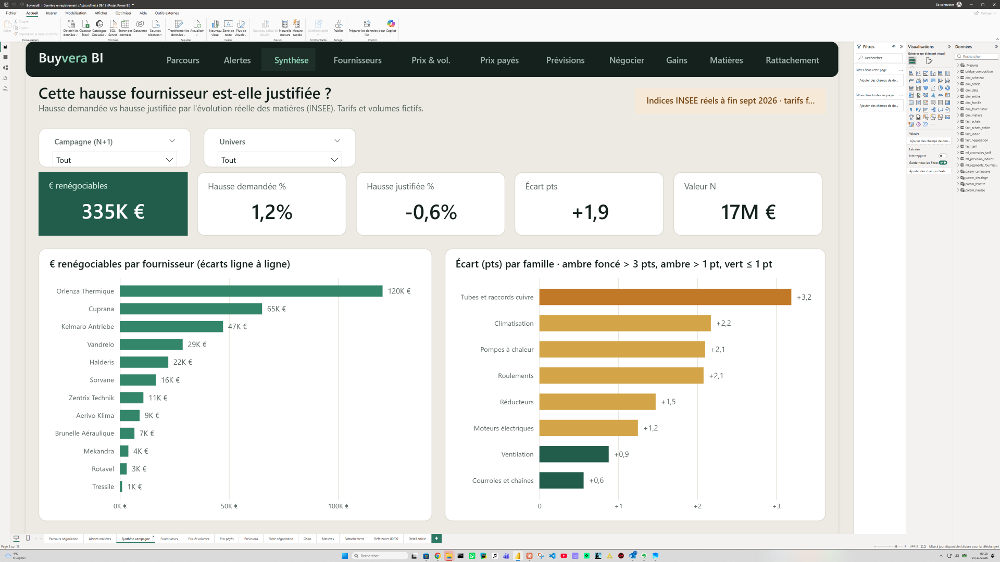
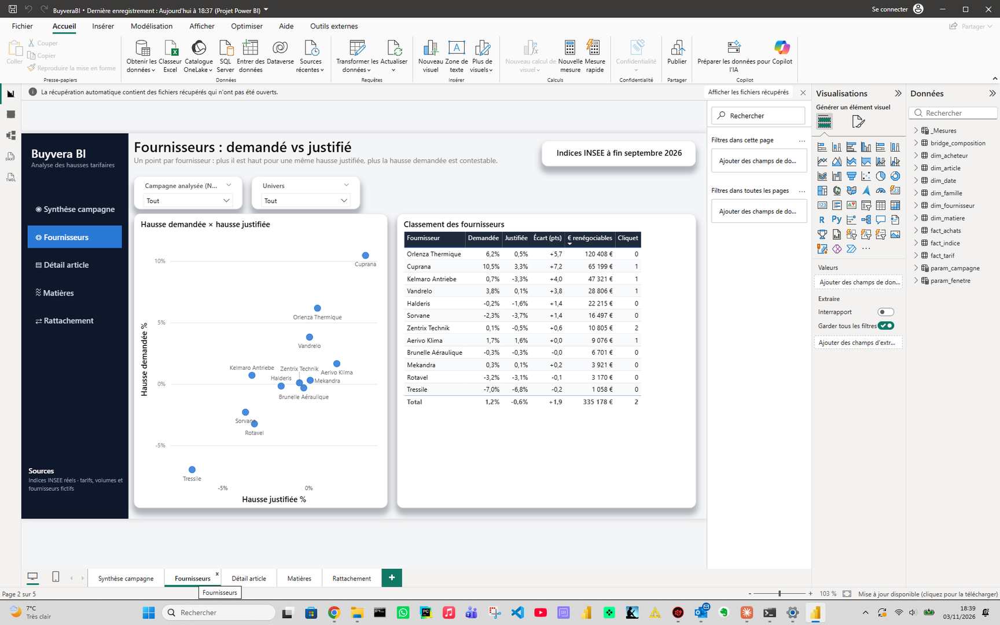
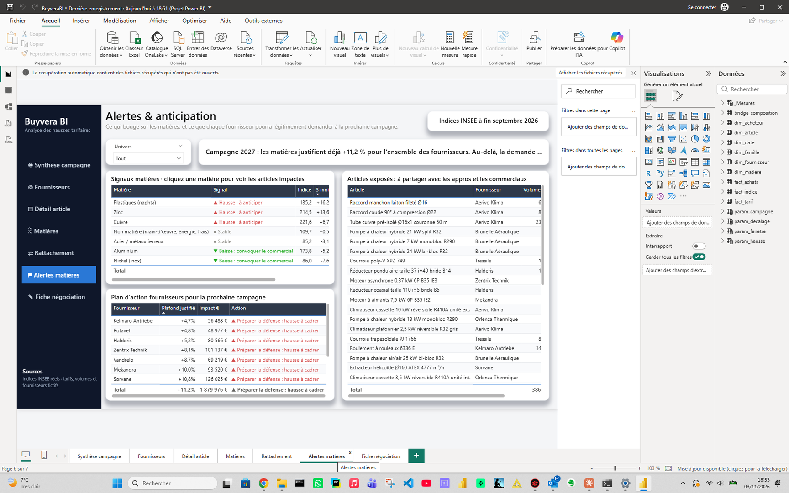
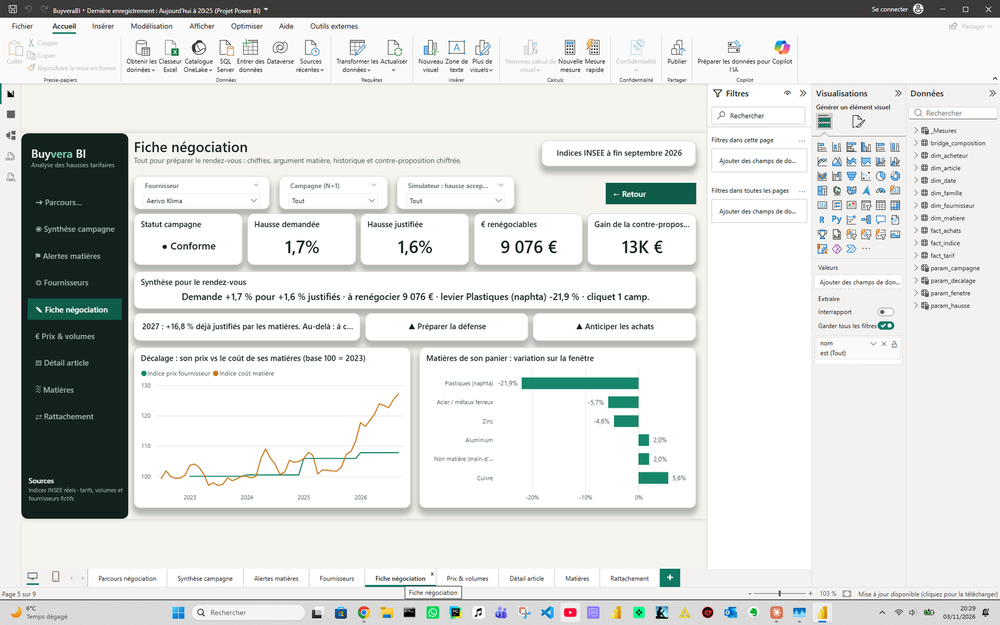

# Buyvera BI : cette hausse fournisseur est-elle justifiée ?

Chaque année, les fournisseurs envoient leurs nouveaux tarifs avec une hausse « justifiée par les matières premières ».
Ce projet Power BI, aux couleurs de Buyvera, compare la hausse demandée avec l'évolution **réelle** des matières qui composent chaque produit
(indices INSEE), et dit à l'acheteur, fournisseur par fournisseur, combien d'euros il peut renégocier, et ce qu'il
doit anticiper pour la campagne suivante.



> **Campagne 2026 : les fournisseurs demandent +1,2 % quand les matières justifient −0,6 %. 335 k€ sont renégociables,
> dont 120 k€ chez un seul fournisseur. Pour 2027, les cours à fin septembre 2026 justifient déjà +11,2 %.**

🎬 Vidéo de présentation (55 s, vision achats) : [`docs/video/buyvera_promo.mp4`](docs/video/buyvera_promo.mp4)

Indices matières réels (INSEE), tarifs, volumes et fournisseurs fictifs. La logique métier vient de 20 ans de
distribution industrielle (transmission mécanique et CVC).

## Ce que fait le rapport

| Page | Question à laquelle elle répond |
|---|---|
| **Parcours négociation** | Point d'entrée : 5 étapes (détecter, chiffrer, cibler, comprendre, négocier), chacune ouvre sa page ; courbe prix fournisseurs vs coût matière. |
| **Synthèse campagne** | Combien d'euros renégocier, chez qui, sur quelles familles ? |
| **Fournisseurs** | Qui demande plus que ses matières ne le justifient ? Nuage animé 2024 → 2026, classement avec statut. |
| **Détail article** | De quoi est fait cet article, comment ont évolué ses matières et son prix sur 4 campagnes ? |
| **Matières** | Quels indices bougent ? Fenêtre de référence (3, 6, 12 mois) et **décalage d'application** paramétrables, délai de répercussion des hausses vs des baisses. |
| **Rattachement** | Quelle part des références tarif se rattache seule à l'ERP (objectif 80 %) ? Liste des propositions à valider. |
| **Alertes matières** | Ce qui monte ou baisse avant que le fournisseur ne le dise : signal 3 mois, plafond justifié pour la campagne suivante, articles exposés et plan d'action (convoquer le fournisseur, préparer la défense, limiter ou anticiper les achats). |
| **Prix & volumes** | Année sur année, à date : montant, volumes, **effet prix à volumes constants**, surcoût par fournisseur, une courbe de volumes par année. |
| **Fiche négociation** | Tout pour le rendez-vous : statut, argument rédigé, **courbe de décalage prix vs coût matière**, levier matière coloré, **simulateur de contre-proposition**. Accessible par clic droit → Extraire depuis n'importe quel fournisseur. |

| Fournisseurs | Alertes matières | Fiche négociation |
|---|---|---|
|  |  |  |

## Les données

| Donnée | Nature | Volume |
|---|---|---|
| Indices cuivre, aluminium, nickel, zinc, métaux ferreux, naphta | **réels**, INSEE BDM (API SDMX), mensuels 2022-01 → 2026-09 | 7 séries |
| Part non matière (main-d'œuvre, énergie) | hypothèse affichée : +2 %/an | 1 série |
| Fournisseurs, familles, acheteurs | fictifs | 12 · 8 · 3 |
| Articles et composition matière | fictifs, 2 à 4 matières par article | 3 000 · 11 700 lignes |
| Tarifs | fictifs, 4 campagnes (2023 → 2026) | 10 142 lignes |
| Achats | fictifs, mensuels, Pareto 82/20 | 62 095 lignes |

Les hausses fictives sont **construites à partir des vrais indices** : hausse demandée = hausse justifiée + biais du
profil fournisseur + bruit. Cinq comportements sont injectés et vérifiés automatiquement (`docs/rapport_controle.md`) :
honnêtes (±1 pt), opportunistes (+3 à +8 pts), effet cliquet (pas de baisse quand les matières baissent),
références modifiées, articles entrants et sortants.

## Modélisation

Schéma du pipeline : [`docs/pipeline_buyvera.drawio`](docs/pipeline_buyvera.drawio) (à ouvrir dans draw.io).

- **Modèle en étoile** au format **PBIP / TMDL**, entièrement généré par `scripts/build_pbip.py` et versionné dans Git :
  17 tables, 14 relations un-vers-plusieurs filtrées dans un seul sens, table de dates journalière.
- **Table pont** `bridge_composition` (article × matière). Aucune relation bidirectionnelle : la hausse justifiée
  est calculée article par article puis pondérée par les volumes, ce qui évite les doubles comptes.
- **Définitions uniques** (`CLAUDE.md`) appliquées en Python, en DAX et dans le tableau de bord Claude :
  hausse demandée = Σ(prix N+1 × volume N) / Σ(prix N × volume N) − 1 ; hausse justifiée = Σ(part × variation matière).
- **Précalcul** (`scripts/precalcul_hausses.py`) des hausses par article × campagne × fenêtre × décalage : les 53 mesures
  répondent en une seconde au lieu d'une minute, aux mêmes chiffres près au centime.
- **Sécurité par ligne** : un rôle `Acheteur` (email = `USERPRINCIPALNAME()`, propagé famille → article → faits)
  et un rôle `Direction`. Testé : chaque acheteur voit ses 4 familles, les montants s'additionnent au total (`docs/rls.md`).
- **Documentation** : chaque table, colonne et mesure a sa description dans le TMDL, exportée dans
  [`docs/dictionnaire.md`](docs/dictionnaire.md).

## Même analyse, deux outils

Le volet 2 refait l'analyse en **tableau de bord Claude**, à partir des mêmes CSV. Les 5 chiffres clés sont
recalculés en Python et comparés aux mesures DAX lues dans le modèle Power BI : **écart nul sur les cinq**.
Power BI reste la version industrialisée (RLS, rafraîchissement, exploration) ; le tableau de bord Claude sert à
préparer un rendez-vous ou une note à la direction, avec un argument rédigé par fournisseur.
Détail et limites : [`docs/comparatif.md`](docs/comparatif.md).

## Reproduire

Windows, Python 3.12 (pandas, requests), Power BI Desktop.

```bash
python scripts/fetch_indices.py        # indices INSEE (API SDMX)
python scripts/generate_synthetic.py   # données fictives, graine fixe : résultats reproductibles
python scripts/precalcul_hausses.py    # hausses par article
python scripts/controles.py            # contrôles bloquants + docs/rapport_controle.md
python scripts/build_pbip.py           # modèle TMDL + rapport
python scripts/export_dictionary.py    # docs/dictionnaire.md
```

Ouvrir ensuite `pbip/BuyveraBI.pbip` dans Power BI Desktop (Fichier → Ouvrir) et cliquer sur **Actualiser**.
Le paramètre `DossierDonnees` pointe vers `data/processed/` : l'adapter si le dépôt est cloné ailleurs.
Les requêtes de validation sont dans `tests/dax/` (`scripts/dax_query.ps1` interroge le modèle ouvert).

## Arborescence

```
data/raw · data/processed · data/controle   indices bruts, tables du modèle, calculs de contrôle
scripts/                                    pipeline Python, génération du PBIP, export, tests DAX
pbip/                                       BuyveraBI.pbip, modèle sémantique TMDL, rapport, thème
claude-dashboard/                           volet 2 : agrégats et page du tableau de bord Claude
docs/                                       captures, contrôles, RLS, dictionnaire, comparatif
tests/dax/                                  requêtes de validation sur le moteur Power BI
```

## Ce que je dirais en entretien

Les tarifs et les volumes sont synthétiques ; les indices matières sont réels et la mécanique de campagne tarifaire,
d'effet cliquet et de rattachement de références vient du terrain. Le point le plus utile pour un acheteur n'est pas
le chiffre de la campagne passée : c'est de savoir, avant le fournisseur, ce que les matières justifient déjà pour la
suivante.

---
Patrice Duclos · Data Analyst / BI · Lyon
