# Buyvera BI : l'outil qui dit à l'acheteur si la hausse fournisseur est justifiée

> Projet Power BI de bout en bout : données, modèle, DAX, interface, machine learning et contrôle qualité.
> Patrice Duclos · Data Analyst / BI · Lyon · novembre 2026
> Code : [github.com/PDUCLOS/buyvera-bi](https://github.com/PDUCLOS/buyvera-bi) · Vidéos : `video/buyvera_site.mp4` (2 min, pour le site) et `video/buyvera_social.mp4` (24 s, verticale, réseaux sociaux)

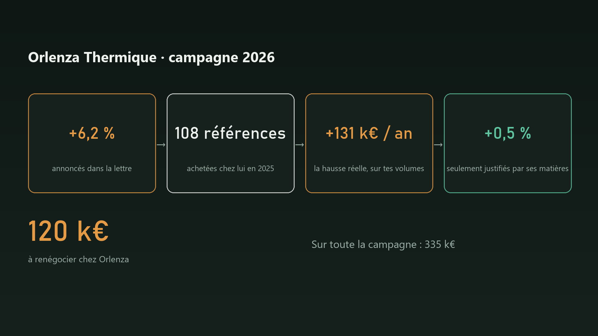

---

## En une phrase

Chaque année, les fournisseurs annoncent une hausse « à cause des matières premières ». Buyvera BI confronte chaque
tarif aux **cours réels** des matières (indices INSEE), chiffre en euros ce qui est renégociable, prévient l'acheteur
**avant** le fournisseur, vérifie que **chaque site du groupe paie le meilleur prix**, et **mesure ce que la négociation a rapporté**.

## Les chiffres de la démonstration

| | |
|---|---|
| **+1,2 %** demandés par les fournisseurs en 2026 | quand les matières justifient **−0,6 %** |
| **335 k€** renégociables sur la campagne 2026 | dont 120 k€ chez un seul fournisseur |
| **+11,2 %** déjà justifiés pour 2027 | avec les indices à fin septembre 2026 |
| **624 k€** payés au-dessus du meilleur prix du groupe | sur 3 sites, dont 2 rachetés |
| **524 k€** d'économies obtenues en 3 campagnes | **51 %** du potentiel transformé |
| **0 écart** entre Power BI et le recalcul Python | sur les 7 chiffres clés |

Indices matières réels (INSEE). Tarifs, volumes, sites et fournisseurs fictifs, générés avec une graine fixe.

---

## Le problème métier

Vingt ans de distribution industrielle (transmission mécanique, CVC) m'ont appris que l'acheteur négocie souvent à l'aveugle :

- aucun lien chiffré entre la hausse demandée et l'évolution réelle des matières qui composent le produit ;
- les baisses de matières ne sont presque jamais répercutées (effet cliquet) ;
- le fournisseur connaît les cours avant l'acheteur ;
- dans un groupe qui a racheté des sites, le même article est payé plus cher d'un site à l'autre, et les tarifs
  négociés ne sont pas toujours appliqués dans les ERP ;
- personne ne mesure ce que la négociation a réellement rapporté.

## La réponse : un parcours, pas un tableau de chiffres

L'outil suit les questions que l'acheteur se pose avant un rendez-vous fournisseur, dans l'ordre.

| Étape | Question | Page |
|---|---|---|
| 1 Détecter | Quelles matières montent ou baissent ? | Alertes matières |
| 2 Chiffrer | Combien renégocier sur la campagne ? | Synthèse |
| 3 Cibler | Qui demande plus que ses matières ? | Fournisseurs |
| 4 Comprendre | Prix et volumes, année sur année | Prix & volumes |
| 5 Négocier | Argument et contre-proposition | Fiche négociation |
| + Aligner | Le même article payé moins cher ailleurs ? | Prix payés |
| + Prouver | Combien la négociation a-t-elle rapporté ? | Gains |

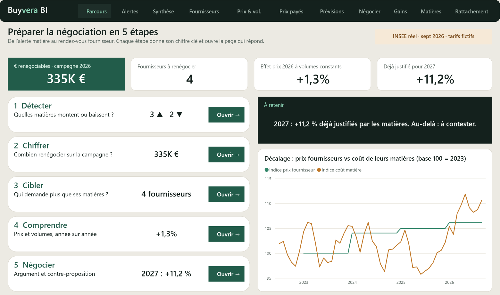
*Page d'accueil : 5 étapes, chacune avec son chiffre clé et un bouton qui ouvre la page. À droite, la courbe de décalage entre prix fournisseurs et coût de leurs matières.*

---

## Les écrans

### Synthèse de campagne
Combien d'euros renégocier, chez qui, sur quelles familles.

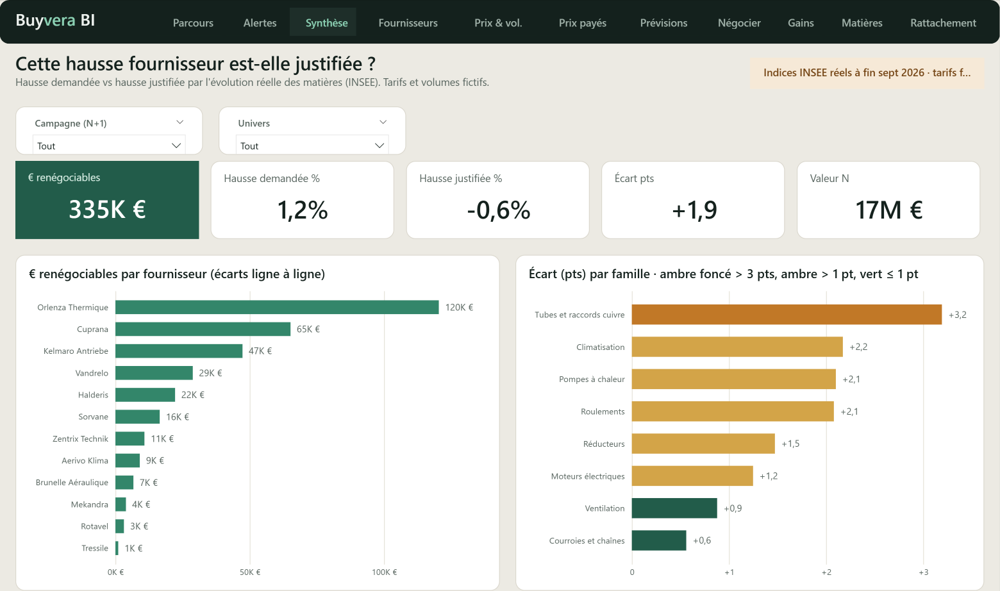

### Alertes matières : savoir avant le fournisseur
Signal à 3 mois par matière, plafond justifié pour la campagne suivante, articles exposés et plan d'action.
Une baisse ? On convoque le fournisseur et on limite les achats avant la négociation. Une hausse ? On prépare la défense et on anticipe les achats.

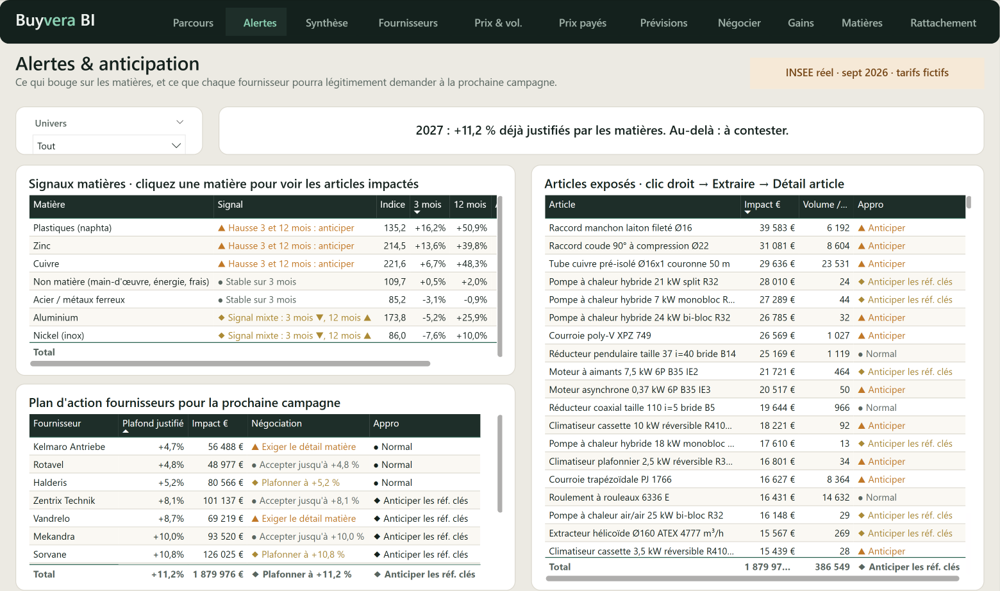

### Fournisseurs : qui demande plus que ses matières
Nuage demandé × justifié, animé de 2024 à 2026, et classement avec statut (à renégocier, à surveiller, conforme).

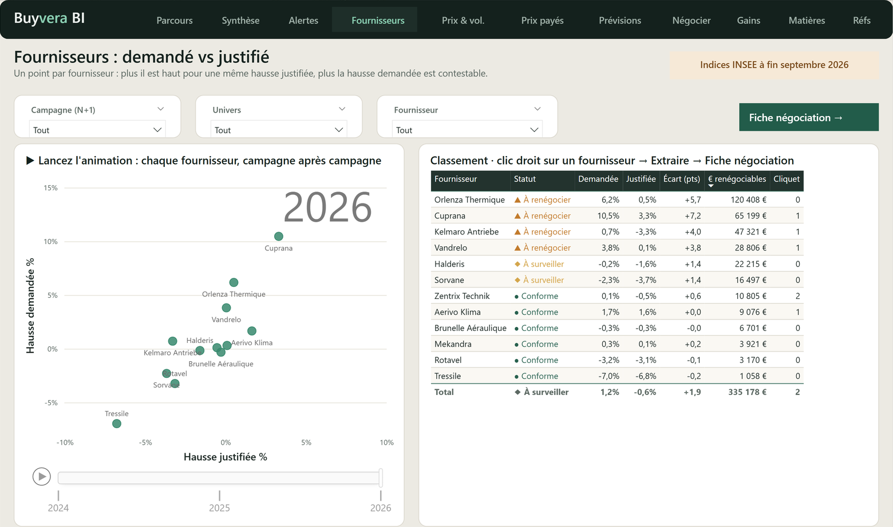

### Prix & volumes, année sur année
Montant, volumes, **effet prix à volumes constants**, surcoût par fournisseur, une courbe de volumes par année.

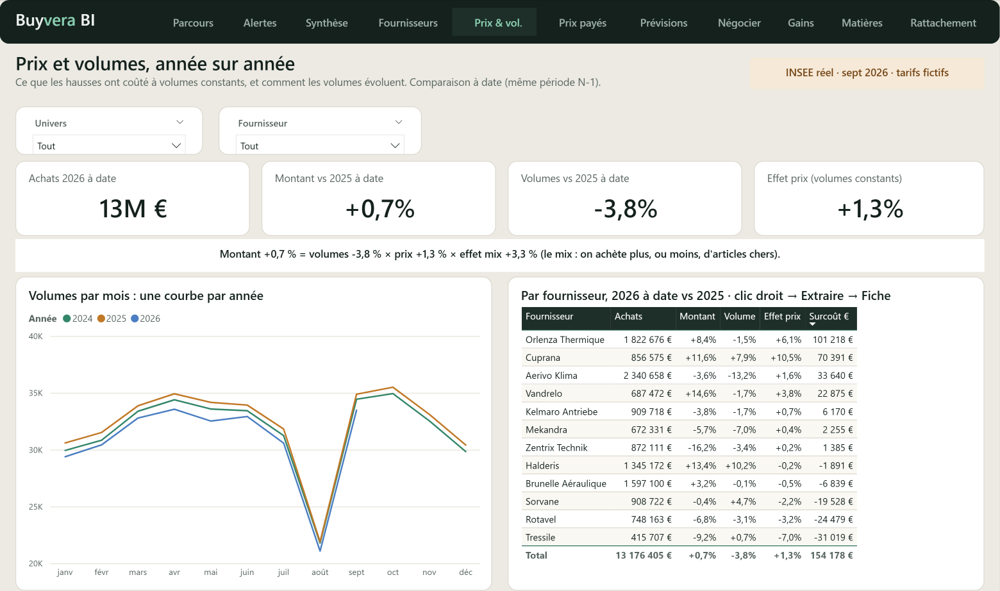

### Prix payés dans le groupe
Surcoût de chaque site par rapport au meilleur prix payé dans le groupe, écarts d'application des tarifs dans les ERP
(retard d'application, prix mal saisi), et liste des articles à aligner, à transmettre à l'approvisionneur du site.

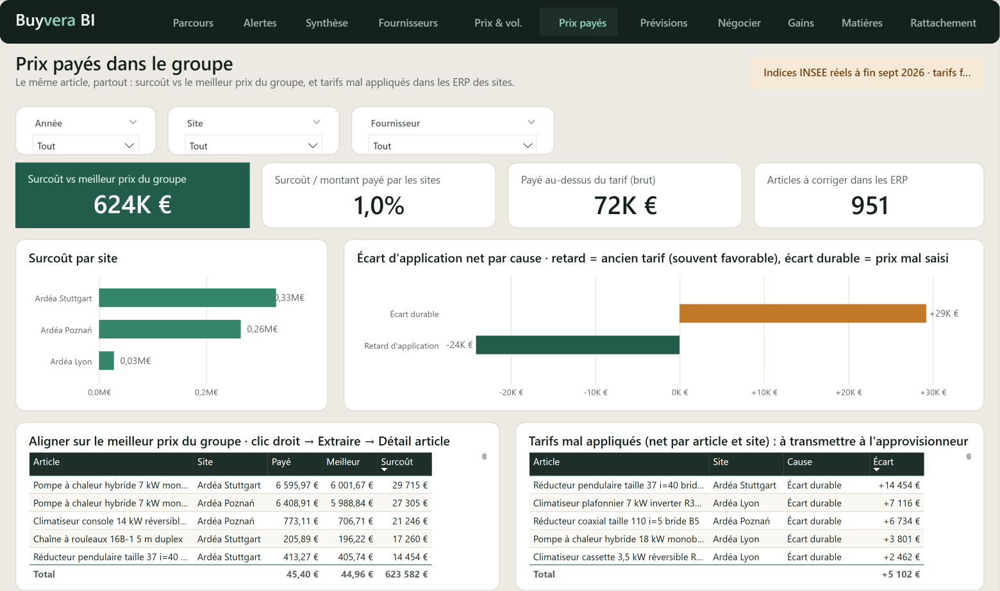

### Prévisions (machine learning)
Hausse justifiable 2027 projetée avec sa fourchette, prévision des indices à 3 mois, segments de comportement
fournisseurs et lignes tarifaires anormales à vérifier en priorité.

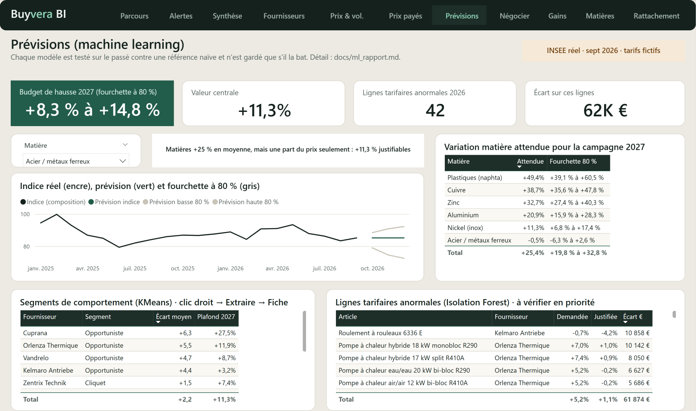

### Fiche négociation : prêt pour le rendez-vous
Statut, argument rédigé, courbe de décalage prix / coût matière, levier matière et **simulateur de contre-proposition**.
Accessible depuis la page Fournisseurs (bouton « Fiche négociation → ») ou le bandeau.

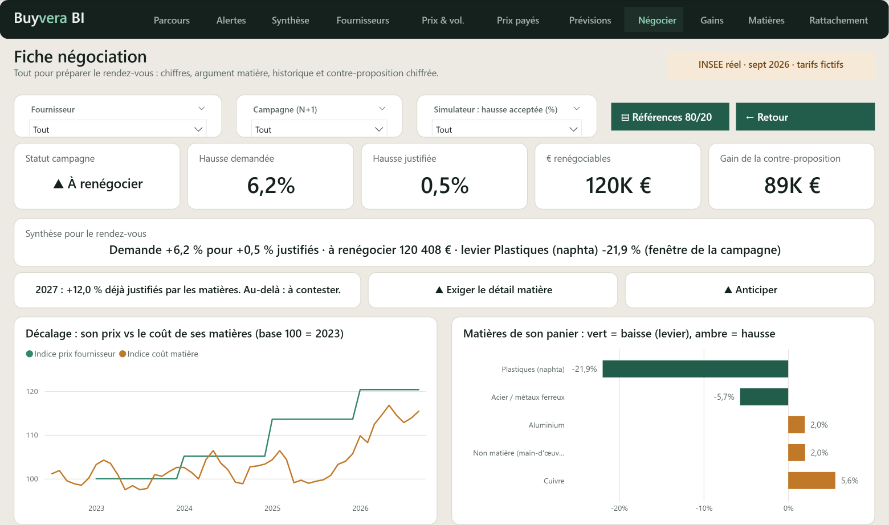

### Gains de négociation
Économies obtenues face au potentiel chiffré avant chaque campagne, taux de transformation, hausse demandée,
justifiée et obtenue par fournisseur.

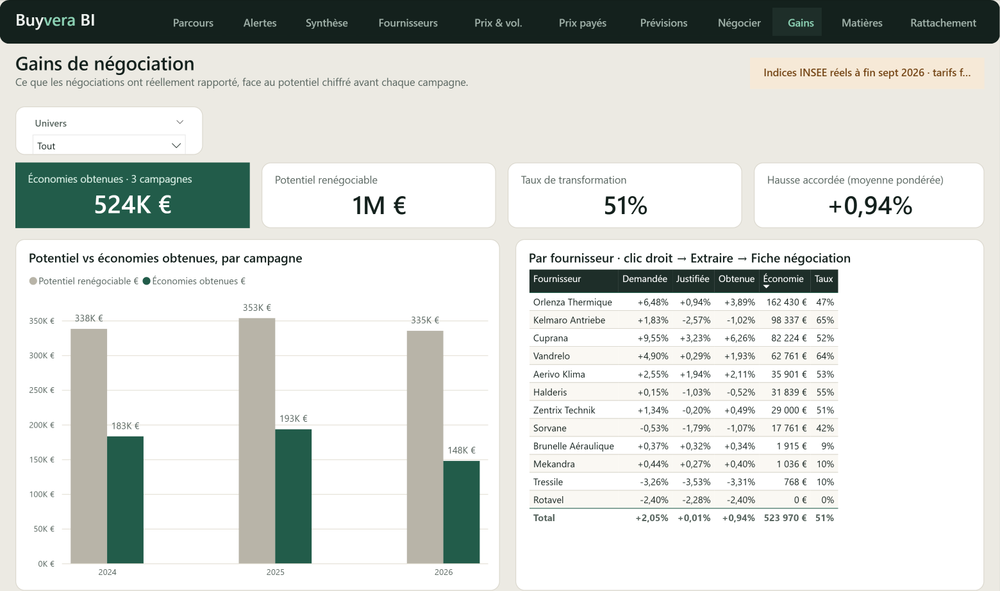

### Matières premières
Indices INSEE depuis 2022, fenêtre de référence (3, 6, 12 mois) et décalage d'application paramétrables, délai de
répercussion des hausses comparé à celui des baisses. Sécurité par ligne : chaque acheteur ne voit que ses familles.

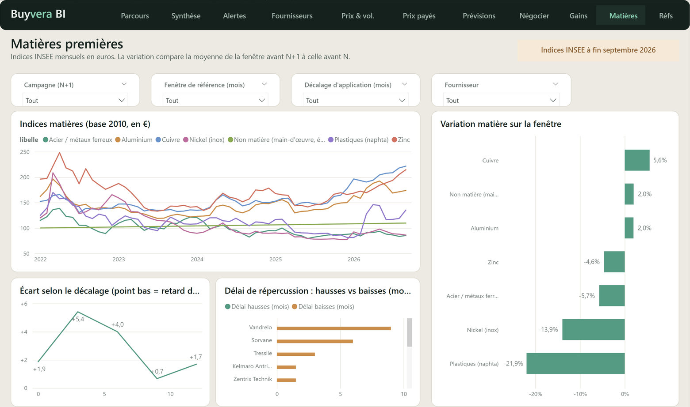

---

## Machine learning : ce que l'historique permet vraiment de prédire

Chaque modèle est testé sur un backtest chronologique (32 dates de départ, réentraîné à chaque date sur le seul passé)
contre une référence naïve, et n'est gardé que s'il la bat.

| Cas d'usage | Résultat | Usage acheteur |
|---|---|---|
| Indices matières à 1-6 mois | LightGBM et lissage **ne battent pas** le naïf (erreur 4,2 % à 1 mois). Le naïf est retenu, avec une fourchette tirée des erreurs passées | plafond 2027 projeté +11,3 % (+8,3 à +14,8 %) |
| Volumes par famille | Holt-Winters : 7,3 % d'erreur contre 9,0 % pour le naïf saisonnier | quantités à anticiper avant la hausse |
| Segmentation fournisseurs | KMeans retrouve les 4 comportements (indice de Rand 1,0) | cibler opportunistes et effets cliquet |
| Lignes tarifaires anormales | Isolation Forest : 90 % des alertes chez les opportunistes | 42 lignes, 62 k€ à vérifier |

Le résultat le plus honnête est le premier : sur des cours de métaux, aucun modèle ne prévoit mieux que « le mois
prochain ressemble au dernier ». L'outil le dit, et donne une fourchette plutôt qu'une fausse précision.

---

## Sous le capot

**Pipeline reproductible en Python**
indices INSEE (API SDMX) → données synthétiques à graine fixe → précalcul des hausses par article → vision groupe et
négociations → machine learning → contrôles bloquants → génération du rapport Power BI.

**Modèle Power BI au format PBIP / TMDL, entièrement généré par script et versionné dans Git**
- 26 tables, 26 relations un-vers-plusieurs à filtrage unidirectionnel, 94 mesures DAX rangées par dossier, 12 pages ;
- table pont article × matière sans relation bidirectionnelle : la hausse justifiée est calculée article par article,
  puis pondérée par les volumes ;
- précalcul Python : les mesures répondent en une seconde au lieu d'une minute, au centime près ;
- sécurité par ligne (rôles Acheteur et Direction), testée ;
- chaque table, colonne et mesure documentée, dictionnaire exporté automatiquement.

**Qualité**
- définitions uniques des indicateurs, appliquées à l'identique en Python, en DAX et dans le tableau de bord Claude ;
- comportements fournisseurs injectés puis retrouvés par des contrôles automatiques ;
- tests DAX exécutés sur le moteur local de Power BI Desktop ;
- contrôle croisé Power BI / Python : écart nul sur les 7 chiffres clés.

**Interface**
Charte Buyvera, navigation par bandeau et parcours en 5 étapes, boutons vers la fiche fournisseur,
segments synchronisés entre pages, info-bulles et animations. Fonctionne entièrement dans Power BI Desktop, sans licence Pro.

**Volet 2 : la même analyse en tableau de bord Claude**
Même CSV, mêmes définitions, un argument de négociation rédigé par fournisseur, sections Prix payés et Gains.
Power BI reste la version industrialisée ; le tableau de bord Claude sert à préparer un rendez-vous ou une note à la direction.

| Outils | |
|---|---|
| BI | Power BI Desktop, DAX, TMDL / PBIP, sécurité par ligne |
| Données | Python (pandas, NumPy), API SDMX INSEE |
| Machine learning | scikit-learn (KMeans, Isolation Forest), statsmodels (Holt-Winters), LightGBM |
| Qualité | contrôles automatiques, tests DAX via ADOMD, Git / GitHub |
| Communication | vidéo générée par script (Pillow, FFmpeg), tableau de bord Claude |

---

## Vidéos de présentation

Sans voix off, vision métier achats, sur un seul exemple (Orlenza Thermique) du début à la fin.

- **Site (2 min, 16:9)** : la lettre du fournisseur, la hausse réelle sur les références et les volumes, le 80/20,
  les alertes, la fiche négociation, les prix payés dans le groupe, les gains, le budget 2027.
- **Réseaux sociaux (24 s, 9:16)** : un message toutes les deux secondes, lisible sans le son.

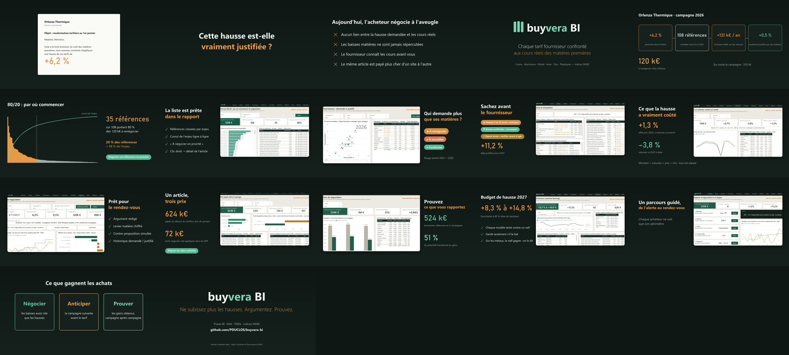

---

## Textes prêts à reprendre

### Carte projet (site freelance, ~40 mots)
**Buyvera BI : négocier les hausses fournisseurs avec des faits.** Power BI qui confronte chaque tarif aux cours réels
des matières, alerte avant le fournisseur, vérifie que chaque site paie le meilleur prix et mesure les gains obtenus.
Python, DAX, TMDL, machine learning.

### Résumé portfolio (~90 mots)
Outil d'aide à la négociation pour les acheteurs industriels. Il compare la hausse demandée par chaque fournisseur à
l'évolution réelle des matières de ses produits (indices INSEE), chiffre les euros renégociables (335 k€ sur la
campagne de démonstration), prévient des hausses et des baisses à venir, repère les écarts de prix entre les sites
d'un groupe (624 k€) et mesure les économies obtenues (524 k€, 51 % du potentiel). Modèle Power BI généré par script,
94 mesures DAX, sécurité par ligne, machine learning testé contre une référence naïve, contrôle croisé Python / DAX à l'écart nul.

### Ce que ce projet montre
- Partir d'une question métier, pas des données.
- Construire un modèle propre et vérifiable : définitions uniques, contrôles, tests, versionnement.
- Dire quand le machine learning n'apporte rien, et le prouver.
- Livrer une interface qu'un acheteur a envie d'ouvrir avant son rendez-vous.
